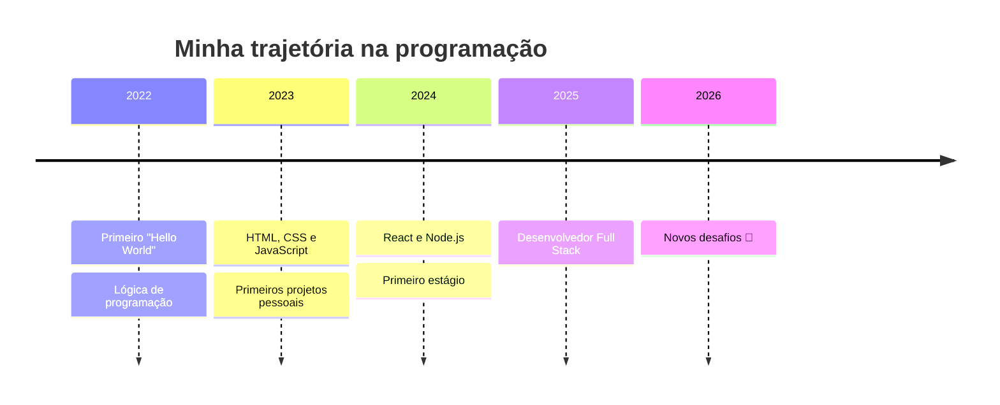

<!-- ===================== CABEÇALHO ANIMADO ===================== -->
<p align="center">
  
</p>

<!-- Texto digitando -->
<p align="center">
  <a href="https://git.io/typing-svg">
    
  </a>
</p>

<!-- Badges de contato -->
<p align="center">
  <a href="https://www.linkedin.com/in/SEU_LINKEDIN"></a>
  <a href="mailto:seuemail@exemplo.com"></a>
  <a href="https://www.instagram.com/SEU_INSTAGRAM"></a>
  <a href="https://seuportfolio.com"></a>
  <br/>
  
</p>

---

## 🧑‍💻 Sobre mim


```js
const sobreMim = {
  nome: "Yuri Cainã",
  localizacao: "Brasil 🇧🇷",
  trabalhandoEm: "Análise de dados", "Automatização para empresa de contabilidade", "Identificar Diabetes - projeto UFU",
  aprendendo: ["TypeScript", "Cloud", "IA"],
  hobbies: ["games", "música", "café ☕"],
  curiosidade: "Escrevo código melhor depois do quinto café",
};
```

- 🔭 Atualmente trabalhando em **[Nome do Projeto](https://github.com/SEU_USUARIO/projeto)**
- 🌱 Estudando **TypeScript, Docker e Cloud**
- 👯 Aberto a colaborar em **projetos open source**
- 💬 Me pergunte sobre **JavaScript, React e Node.js**
- ⚡ Fato curioso: **adicione algo seu aqui**

---

## 🛠️ Tecnologias e ferramentas

<p align="center">
  
  <br/><br/>
  
  <br/><br/>
  
</p>

<details>
<summary><b>📊 Clique para ver meu nível em cada área</b></summary>
<br/>

| Área | Nível |
|------|-------|
| Front-end |  |
| Back-end |  |
| Banco de dados |  |
| DevOps |  |
| UI/UX |  |

</details>

---

## 🚀 Projetos em destaque

<p align="center">
  <a href="https://github.com/SEU_USUARIO/REPO_1">
    
  </a>
  <a href="https://github.com/SEU_USUARIO/REPO_2">
    
  </a>
</p>

<details>
<summary><b>📂 Ver mais projetos</b></summary>
<br/>

| Projeto | Descrição | Tecnologias |
|---------|-----------|-------------|
| [🛒 Projeto 1](https://github.com/SEU_USUARIO/REPO_1) | Breve descrição do que ele faz | React · Node.js |
| [📱 Projeto 2](https://github.com/SEU_USUARIO/REPO_2) | Breve descrição do que ele faz | TypeScript · Next.js |
| [🤖 Projeto 3](https://github.com/SEU_USUARIO/REPO_3) | Breve descrição do que ele faz | Python · FastAPI |

</details>

---

## 📈 Estatísticas no GitHub

<p align="center">
  
  
</p>

<p align="center">
  
</p>

<details>
<summary><b>📊 Ver gráfico de contribuições</b></summary>
<br/>
<p align="center">
  
</p>
</details>

---

## 🐍 A cobrinha comendo minhas contribuições

<p align="center">
  <picture>
    <source media="(prefers-color-scheme: dark)" srcset="https://raw.githubusercontent.com/SEU_USUARIO/SEU_USUARIO/output/github-snake-dark.svg" />
    <source media="(prefers-color-scheme: light)" srcset="https://raw.githubusercontent.com/SEU_USUARIO/SEU_USUARIO/output/github-snake.svg" />
    
  </picture>
</p>

---

## 🗺️ Minha jornada



---

<details>
<summary><b>💡 Uma citação para você</b></summary>
<br/>
<p align="center">
  
</p>
</details>

<!-- ===================== RODAPÉ ===================== -->
<p align="center">
  <i>Obrigado pela visita! Fique à vontade para explorar meus repositórios ⭐</i>
</p>

<p align="center">
  
</p>
